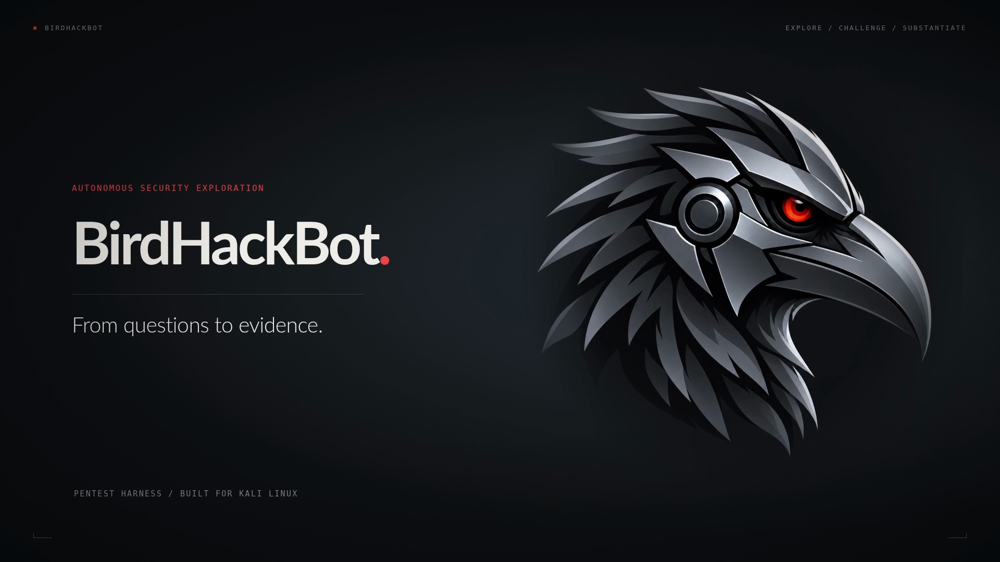
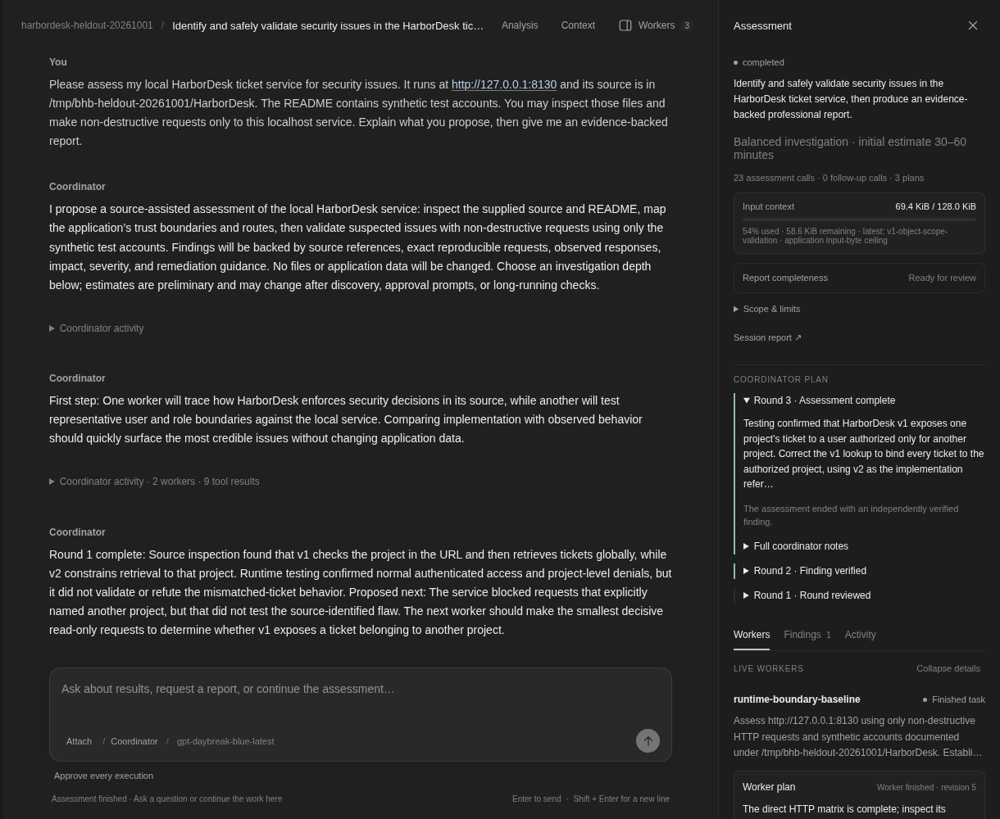
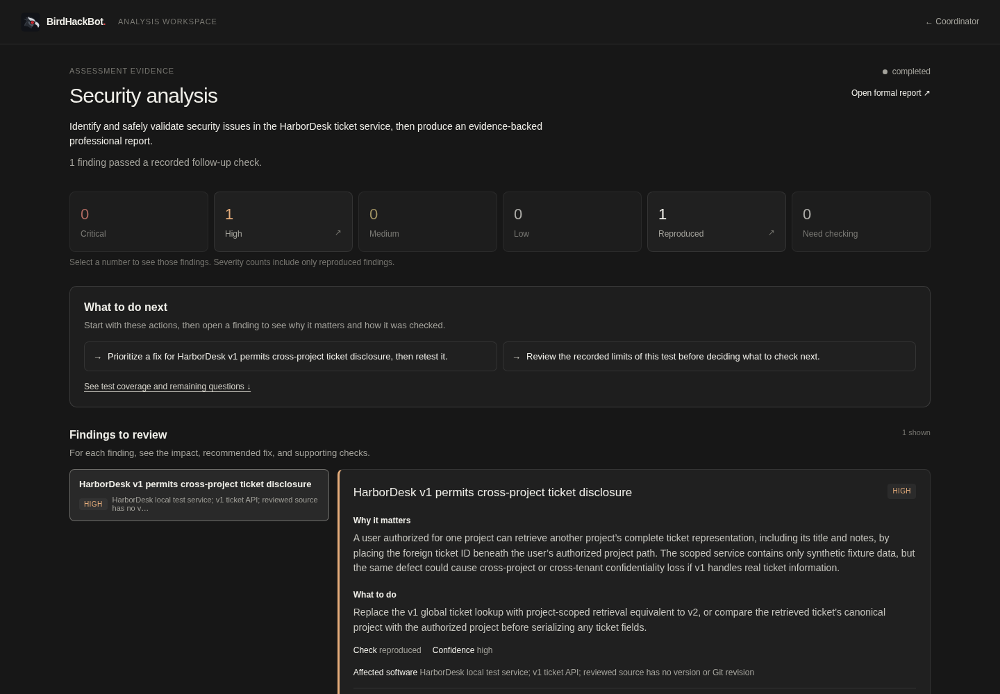

# BirdHackBot

<p align="center">
  
</p>

**From questions to evidence.**

BirdHackBot is an interactive penetration-testing harness built for Kali Linux. Describe a system or a security question in plain language. Its coordinator helps you choose a useful test, delegates independent work to specialist workers, and revises the plan as evidence arrives. You stay in the conversation, see what is running, and decide how much execution to approve.

The goal is practical: find weaknesses, check whether they are real, and make the results clear enough to act on. Kali tools, browser automation, source inspection, CVE research, and task-specific guidance give each investigation the capabilities it needs.

[](docs/media/birdhackbot-launch.mp4)

## An assessment you can follow

The coordinator proposes a plan with an estimated depth and explains each step before workers act. Workers can investigate separate leads in parallel, use installed Kali tools or small task-local helpers, and return evidence for the coordinator to assess. A failed lead can change the next step; a promising one can be handed to another worker for an independent check.

You can talk to the coordinator while work is underway, inspect worker activity and saved artifacts, or pause or stop a run. Approval settings let you review every action, review risky actions, or allow execution within the session. The operator defines scope and remains responsible for authorization.



## Results that lead somewhere

Every run keeps its scope, actions, outputs, captured screenshots, and conclusions together. Long investigations retain useful evidence outside the model's active context so workers and the coordinator can return to it. The Analysis workspace separates reproduced findings from leads that still need checking. It shows why a finding matters, the evidence behind it, and what to fix or test next. When browser work is recorded, you can explore opened pages, actual navigation, observed links, and their captures; missing link records are shown as gaps. Source-backed findings can show the relevant code lines and suggested correction.

Put related sessions in a customer folder to compare runs on the same system. The project view keeps each run's evidence distinct, tracks explicit retests, and helps reveal what remains untested. Its analysis guide answers questions about the saved results in plain language and can suggest a follow-up. A project-level follow-up opens a **new session in that folder**; a suggestion from one assessment can continue that assessment. Neither starts a test until you choose to send the request and approve the plan.

Ask the coordinator or analysis guide for an OWASP WSTG- or PTES-aligned report in Markdown or PDF. Reports link back to saved evidence; the analysis guide can also make a new, edited report draft while preserving the earlier version. PDF exports retain an editable Markdown source. Reports are drafts for professional review, and they identify missing evidence.



## Start on Kali Linux

Follow the [Kali installation guide](docs/runbooks/kali-installation.md) for the required baseline and optional assessment tools. From a checkout with Go 1.24.2 or newer:

```sh
go build -buildvcs=false -o birdhackbot-web ./cmd/birdhackbot-web
go build -buildvcs=false -o birdhackbot ./cmd/birdhackbot
./birdhackbot-web
```

Open the local URL printed by the server (`http://127.0.0.1:8080/` by default). Start with a conversation; there is no assessment form to complete. The terminal interface uses the same coordinator, workers, approvals, and session evidence:

```sh
./birdhackbot
```

The web app is the richer workspace for customer folders, attachments, browser previews, and Analysis. The [web application guide](docs/runbooks/web-application.md) covers both the everyday workflow and the terminal commands.

## Choose how the model runs

- **ChatGPT subscription:** sign in from web Settings to use the local subscription bridge with your Codex account, without switching to API-key billing. Access depends on your account and the provider connection. See [subscription setup](docs/runbooks/subscription-bridge.md).
- **Local model:** connect an OpenAI-compatible local endpoint. The included profile example supports Qwen 3.8; model, context window, and concurrency must match the actual local server. Copy [model-profiles.example.json](config/model-profiles.example.json) to `config/model-profiles.local.json` and edit your endpoint and model ID.

Switch configured profiles from the model selector beneath the web chat or `/settings` in the terminal. For an air-gapped deployment, use a local model and enforce the network boundary outside the app as well as setting `BIRDHACKBOT_RESEARCH_MODE=air_gapped`. The setting disables the app's connected research path; by itself it is not a network sandbox.

## Built for careful, evidence-led work

BirdHackBot records the operator's declared target boundaries and selected approval level. The operator remains responsible for authorization; formal engagement details can be retained with the session and report. Commands, tool output, and model-written conclusions remain available for review. A negative tool result is reported for what it actually tested.

The server binds to loopback by default and has no built-in authentication, target-network sandbox, or enforced target allowlist. Keep it inside an appropriate Kali assessment environment. Stronger validation on unfamiliar targets and end-to-end air-gapped deployment remain active work; see the [acceptance gates](docs/runbooks/acceptance-gates.md) for what has been demonstrated.

## Explore the project

| Guide | What it covers |
| --- | --- |
| [Web application](docs/runbooks/web-application.md) | Sessions, approvals, workers, browser work, and Analysis |
| [Tool capabilities](docs/runbooks/tool-capabilities.md) | Kali commands, browser automation, research, and evidence |
| [Architecture](docs/architecture.md) | Coordinator, worker, context, and evidence design |
| [Kali installation](docs/runbooks/kali-installation.md) | Required platform setup and optional tools |
| [PROJECT.md](PROJECT.md) | Repository structure, build, and test commands |
| [TASKS.md](TASKS.md) | Current implementation work and validation |

Run `./scripts/ci.sh` for the repository's deterministic checks. Earlier plans and the pre-rebuild implementation are retained under `docs/archive/` and `legacy/` for reference.
